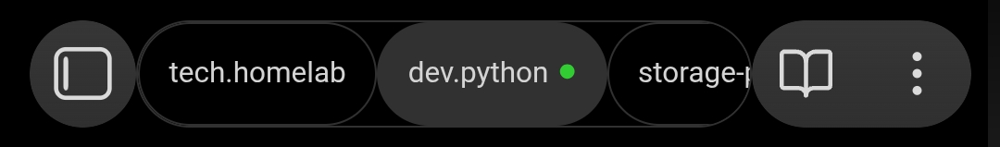

# obsidian-mobile-tab-bar

<div align="center">

[](https://github.com/nnyj/obsidian-mobile-tab-bar/stargazers)
[](https://github.com/nnyj/obsidian-mobile-tab-bar/releases)
[](https://github.com/nnyj/obsidian-mobile-tab-bar/releases/latest)
[](https://github.com/nnyj/obsidian-mobile-tab-bar/actions)

</div>

Browser-style tab bar for switching between open notes on Obsidian mobile. Replaces the title bar with a scrollable row of tabs. Desktop is unaffected.



## Features

- Scrollable row of tabs when multiple notes are open
- Tap to switch, long-press to close
- Active tab auto-scrolls into center view
- Optional save indicator dot (green = saved, red = pending), requires [autosave-control](https://github.com/slateblu3/obsidian-autosave-control)

> [!NOTE]
> The save dot reads `.save-status-icon` from autosave-control's DOM and may break if that plugin changes its class names.

## Install

Search "Mobile Tab Bar" in Settings > Community plugins > Browse.

Manual: download `main.js`, `styles.css`, `manifest.json` from [Releases](https://github.com/nnyj/obsidian-mobile-tab-bar/releases) into `.obsidian/plugins/mobile-tab-bar/`.

## Customization

Override CSS classes in a snippet:

```css
.mtb-tab-bar { background: var(--background-secondary); border-radius: 8px; }
.mtb-tab     { font-size: 11px; padding: 0 8px; }
```

## Build

```sh
npm install
npm run build   # output: main.js
npm run dev     # watch mode
```

## License

[MIT](LICENSE)
